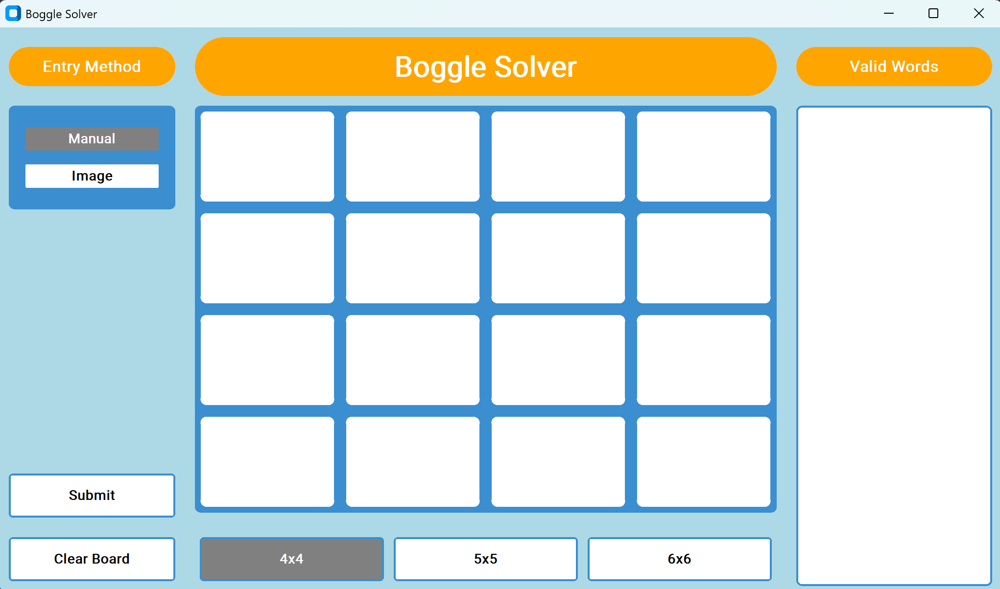

# Boggle Solver

The desktop Boggle board solver was built with Python and CustomTkinter. 
There are two ways to enter letters on the board: type manually or provide an image
of a Boggle or Boggle-like board. Word list generation uses a trie that load dictionary words 
and depth-first search is used for word finding and verification.



## Table of Contents

- [Objective](#objectives)
- [What is Boggle?](#what-is-boggle)
  - [Classic Boggle](#classic-boggle)
  - [Rules this project follows](#rules-this-project-follows)
  - [Larger boards](#larger-boards)
- [Installation](#installation)
- [Usage](#usage)
- [Features](#features)
  - [Manual versus OCR image-based entry method](#manual-versus-ocr-image-based-entry-method)
  - [Interactive board](#interactive-board)
  - [Board size](#board-size)
  - [Word list generation](#word-list-generation)
  - [Miscellaneous](#miscellaneous)
- [How It Works](#how-it-works)
- [Project Structure](#project-structure)
- [Testing](#testing)
- [Known Limitations](#known-limitations)
- [Future Ideas](#future-ideas)
- [Acknowledgments](#acknowledgments)
- [License](#license)

## Objectives

The Boggle Solver is a personal Python project developed to learn about building a GUI, along with designing a data structure and a search algorithm.

The GUI has three main sections:

1. **Left:** player declarations. This is where a person chooses how to enter the letters, submits a filled board, or clears the board.
2. **Center:** the Boggle board of letter tiles. Along the bottom are the buttons that choose the board's dimensions (4x4, 5x5, or 6x6).
3. **Right:** after a filled-in board is submitted, the list of words that can be made.

## What is Boggle?

### Classic Boggle

Boggle is a word-search game for two or more players. Sixteen letter dice are shaken in a tray so that they settle into a 4x4 grid, and a timer (traditionally three minutes) starts. Each player privately writes down as many words as they can find.

A word is found by chaining letters that touch each other, horizontally, vertically, or diagonally. Each die can be used only once in a given word, and words need at least three letters. When time runs out, players compare lists. Any word that more than one player found is crossed out, and the remaining words are scored by length. In the classic scoring, 3-4 letters earn 1 point, 5 letters earn 2, 6 letters earn 3, 7 letters earn 5, and 8 or more earn 11.

One die face reads "Qu". It is treated as a single tile that spells both letters, and it counts as two letters when measuring a word's length.

Boggle was invented by Allan Turoff and first sold by Parker Brothers in the early 1970s. The brand is now owned by Hasbro.

### Rules this project follows

| Rule | In this project                                |
|---|------------------------------------------------|
| Words are chained through touching tiles, including diagonals | Yes                                            |
| A tile can be used once per word | Yes                                            |
| Minimum word length of 3 letters | Yes                                            |
| Words must be in the dictionary | Yes, `enable_word_list.json`                   |
| The "QU" tile spells both letters and counts as two for length | Yes                                            |
| Rolling dice, timer, and scoring | No. The app solves whatever letters you enter. |

### Larger boards

The only expansion here is board size. A 5x5 or 6x6 board follows exactly the same rules as the classic 4x4 board, with more tiles to search.

Some larger commercial editions also add other special faces beyond "Qu", such as multi-letter tiles like "In", "Th", "He", "An", or "Er". Those are **not supported yet**. Apart from "QU", every tile in this program is a single letter.

## Installation

### Requirements

- **Python 3.9 or newer.** It was developed on Python 3.13. Python must include `tkinter`, which comes with the standard Windows and macOS installers. On Linux, install it with `sudo apt install python3-tk`.
- **Tesseract OCR**, which is needed only for the Image entry method. Manual entry works without it.
  - Windows: [installers by UB Mannheim](https://github.com/UB-Mannheim/tesseract/wiki). If Tesseract isn't on your `PATH`, the app also looks in `C:\Program Files\Tesseract-OCR\`.
  - macOS: `brew install tesseract`
  - Linux: `sudo apt install tesseract-ocr`

It was developed and tested on Windows. macOS and Linux should work but haven't been tested.

### Steps

```bash
git clone <repository-url>
cd BoggleSolver

python -m venv .venv
# Windows:      .venv\Scripts\activate
# macOS/Linux:  source .venv/bin/activate

pip install customtkinter pillow opencv-python pytesseract
```

### Dictionary file

The solver loads `enable_word_list.json` from the folder the program is launched from, so keep it in the project folder and start the app from there. The file is a JSON object whose keys are the words:

```json
{
  "apple": "optional text",
  "bat": "optional text"
}
```

Only the keys are used. The values are ignored for now, which leaves room for definitions later (see [Future Ideas](#future-ideas)).

### Run

```bash
python main.py
```

Loading a large dictionary takes a few seconds, so the window may take a moment to appear.

## Usage

**Manual entry (default)**

1. Click into a tile and type. Letters are shown in uppercase, and typing `Q` fills the tile with `QU`.
2. After each letter, focus moves to the next tile, left to right and then top to bottom. Backspace or Delete clears the current tile.
3. Click **Submit**. If every tile is filled, the valid words appear on the right. If any tile is blank, those tiles get a red border and the first one is focused so it can be fixed.

**Image entry**

1. Click **Image** and choose a picture of the board. Sample images are located in "images" directory.
2. In the crop window, drag a box around the letter grid only, from its outer corner to the opposite outer corner. Then click **Crop & Read Board**.
3. The letters are read into the board. Fill in any tiles that couldn't be read, correct any mistakes, and click **Submit**.

Tips for better OCR results:

- Crop tightly. The cropped picture is split into equal tiles, so extra margin shifts the tile boundaries.
- Clean, high-contrast boards, such as a printed or on-screen grid, work much better than photos of physical dice.
- Thin letters, such as `I`, are sometimes read as blank. They're left empty for you to fill in.

**Other controls**

- **4x4 / 5x5 / 6x6** changes the board size. This empties the board and returns to manual entry.
- **Manual** rebuilds an empty board in manual-entry mode.
- **Clear Board** empties the board, returns to manual entry, and clears the word list.

## Features

### Manual versus OCR image-based entry method

Manual entry is the default, tried-and-true way to type in the letters. The more experimental method uses OCR to populate the board quickly. It was intended to improve the user experience, so that one can take a picture of a board and submit it.

I expected that its implementation would not be perfect, so manual entry of any unread letters is built in. The OCR portion can definitely be expanded, not only by improving the accuracy of the OCR technique but by trying other kinds of vision-based extraction.

### Interactive board

Users type letters into individual "tiles" on the screen (the equivalent of a die's face in the physical game), instead of the simpler approach of submitting one string of letters, which is what the early draft used.

### Board size

The classic Boggle dimension is 4x4, but the board has been expanded to 5x5 and 6x6. This variety turned out to be an easy addition to the project.

### Word list generation

The idea for this project came from playing a game of Boggle and wondering which words I had missed, and what kinds of words could be made that I had never been exposed to. For that reason, the tool is meant to be used **after** a game, to learn from it, and not to build a list during the game.

A further improvement would be to show a definition alongside each word, or when a word is clicked.

### Miscellaneous

Buttons change color when selected and hovered over. Possible improvements include general visual design and sound effects.

## How It Works

**Trie.** The dictionary is loaded once at start-up into a trie (prefix tree), where each node is a letter and a flag marks the end of a complete word. This makes two checks very cheap: "does any word start with these letters?" and "is this exact string a word?"

**Search.** The solver runs a depth-first search from every tile, stepping to any of the eight neighboring tiles. It builds up a string as it goes and:

- stops as soon as the string can't be the start of any word (pruning), which keeps the search small,
- marks tiles as used while exploring a path and unmarks them afterwards (backtracking), so a tile is never used twice in one word,
- records the string whenever it is a complete word.

The results are de-duplicated, filtered to three or more letters, and sorted alphabetically. A "QU" tile adds two letters to the string.

**OCR pipeline.** The cropped picture is split into an equal grid of tiles. Each tile is trimmed to avoid grid lines and converted to black text on a white background. Tesseract then reads it in single-character mode, restricted to the letters A-Z. A `Q` is turned into `QU`, and any tile that can't be read is left blank.

**Interface.** The window is built with [CustomTkinter](https://github.com/TomSchimansky/CustomTkinter). Each tile is an entry box that accepts only one letter. The results appear in a single read-only text box. One widget for the whole list keeps Submit responsive even when a large board produces hundreds of words.

## Project Structure

```
BoggleSolver/
├── tests/             # pytest test suite
├── images/            # sample images of boards
├── main.py            # entry point: creates the window and starts the event loop
├── gui.py             # main window: layout, board entry, buttons, results panel
├── solver.py          # Solver: depth-first search over the board
├── trie.py            # Trie: dictionary storage with word and prefix lookups
├── image_reader.py    # OCR: splits a cropped picture into tiles and reads each letter
├── crop_dialog.py     # window for cropping a picture down to the board
├── enable_word_list.json # the dictionary (a JSON object whose keys are words)
└── pytest.ini         # test configuration          
```

## Testing

The project has a [pytest](https://docs.pytest.org/) suite covering the trie, the solver, the OCR logic, the crop dialog, and the main window.

```bash
pip install pytest

pytest                  # everything
pytest -m "not gui"     # skip tests that open real windows
pytest -m "not ocr"     # skip tests that need Tesseract installed
```

Notes:

- ⚠️**SEIZURE WARNING**⚠️: Game window flashes rapidly during parts of testing. If you are sensitive to flashing visuals, please run tests in a headless environment or minimize the test window while it runs.
- The GUI tests open real windows, so they need a display. Expect a window or two to flash on screen while they run. They skip themselves automatically if no display is available.
- The OCR tests that run the real Tesseract skip themselves if it isn't installed.
- The GUI tests use a tiny dictionary created in a temporary folder, so they don't need `enable_word_list.json`.

## Known Limitations

- Only the "QU" tile is special. Other multi-letter tiles that some larger editions use aren't supported.
- OCR reads one character per tile, needs a tight crop, and works best on clean, high-contrast boards. Some letters may be missed, and those tiles are left blank.
- There is no scoring, timer, or word definitions yet.
- Words are listed alphabetically, not grouped by length.
- Loading a large dictionary at start-up takes a few seconds.

## Future Ideas

- Show a definition next to each word, or when a word is clicked.
- Improve OCR accuracy, or try other vision-based ways of reading the board.
- Improve the visual design and add sound effects.
- Support the multi-letter tiles found in some larger editions.
- A post-game review mode: type in the words you found and see which words you missed.
- Click a word to highlight its path on the board.
- Sort or group the list by word length, and show a word count.
- Show scores using the classic length-based scoring.
- Load the dictionary in the background so the window appears immediately.

## Acknowledgments

- [CustomTkinter](https://github.com/TomSchimansky/CustomTkinter) for the interface.
- [Pillow](https://python-pillow.org/), [OpenCV](https://opencv.org/), [pytesseract](https://github.com/madmaze/pytesseract), and [Tesseract OCR](https://github.com/tesseract-ocr/tesseract) for image handling and text recognition.
- The **ENABLE** (Enhanced North American Benchmark LExicon) word list was compiled by Alan Beale and M. Cooper and has been formally released into the Public Domain.
- You can find more information regarding the lexicon in the public [ENABLE documentation](https://github.com/BartMassey/wordlists/blob/main/README-enable2k.txt).

Boggle is a trademark of Hasbro. This project is an independent, personal project and is not affiliated with or endorsed by Hasbro.

## License

This project is released under the [MIT License](LICENSE.txt). These third-party libraries listed above have their own licenses.
